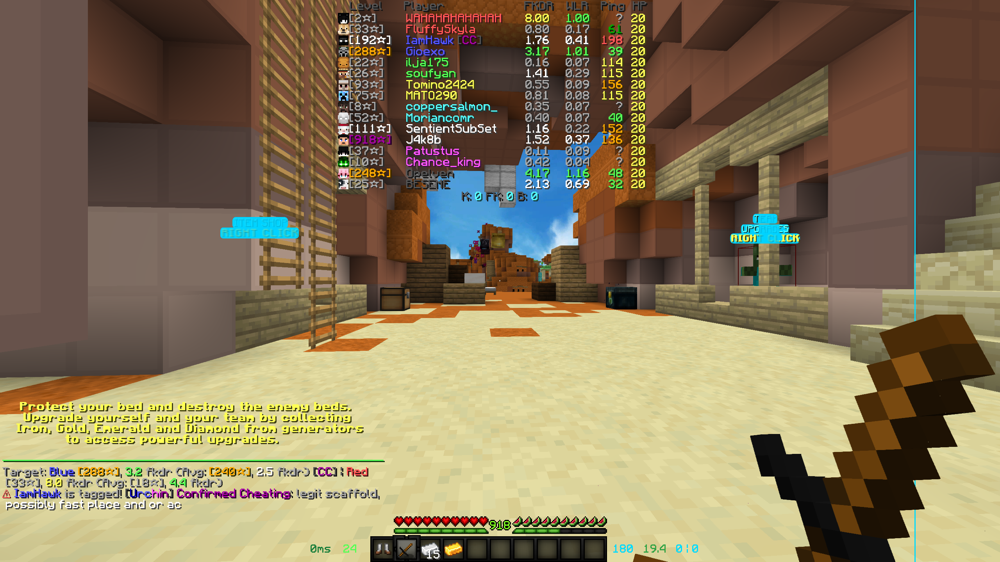
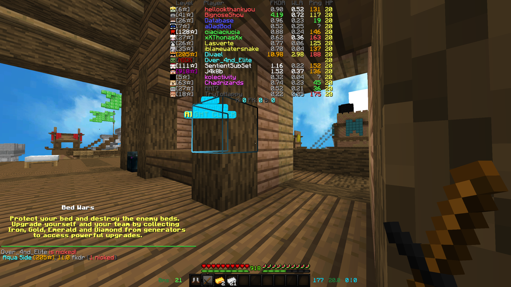
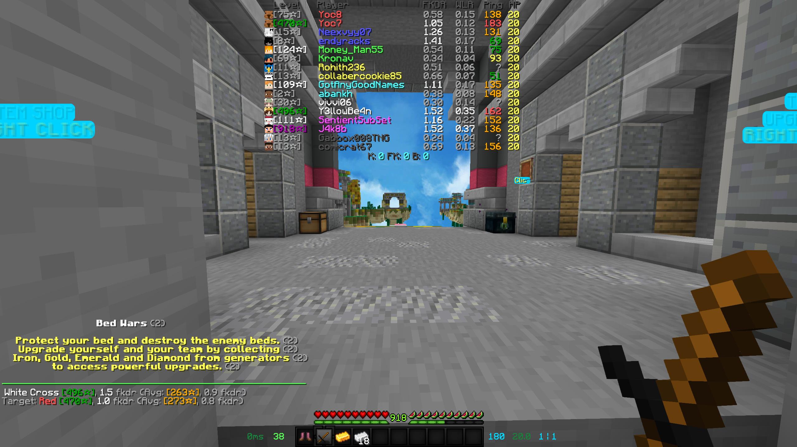
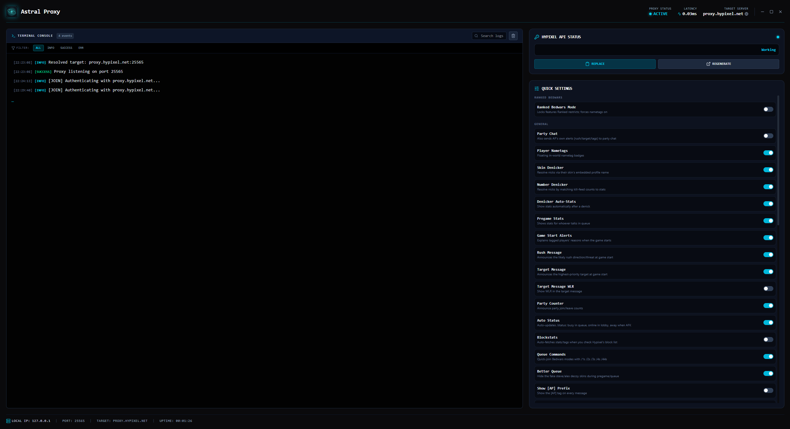
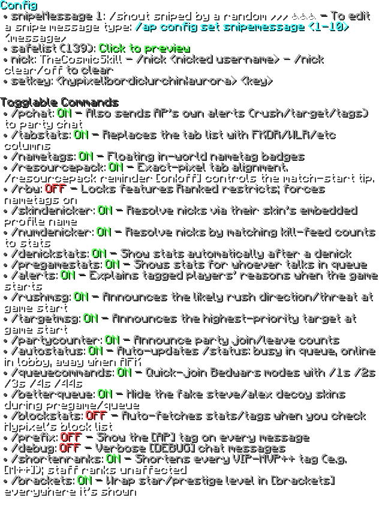
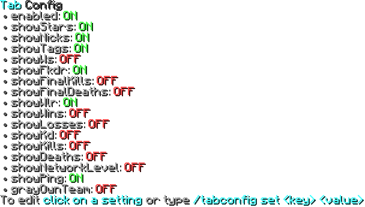
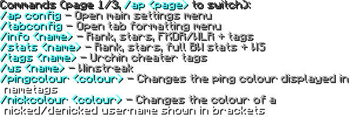
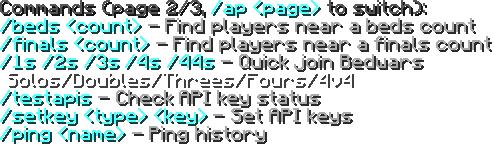
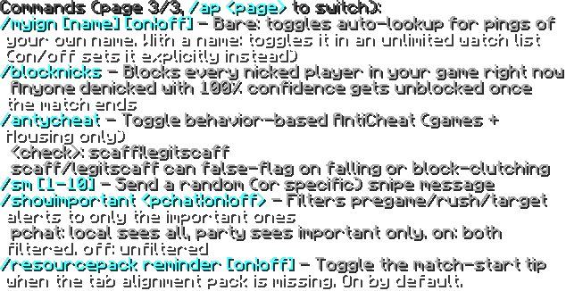

# Astral Proxy

Astral Proxy is a Windows desktop application for Minecraft Java Edition 1.8.9. It sits between your game and Hypixel, reads the Bed Wars roster and match events, and sends an annotated tab list, nametags and chat messages back to your client. Keep your existing Minecraft installation and launch the proxy when you want to use it.

The tab list can show prestige, player names, tags, winstreak, FKDR, WLR, kills, deaths, network level and ping. Number columns share a layout across the roster, ratios align at the decimal point, and the header follows the visible columns. A small server resource pack supplies the invisible glyphs used for precise spacing.

## Gallery

### Match start







### Desktop dashboard



### In-game settings



### Tab list settings



### Command reference







## Connect for the first time

1. Download the portable Windows executable from [Releases](../../releases) and start it.
2. Turn proxy on and add server IP `proxy.hypixel.net` or `127.0.0.1`(if you do not want to interact with windows host files) and ensure resource packs are set to enabled.
4. When prompted, complete Microsoft device sign-in for the Minecraft account you are playing on. The desktop console displays the verification instructions. This is required for the proxy to decrypt hypixel packets(otherwise it wouldn't work).
5. Set your keys by using `/setkey (key)` one by one. If you are playing nicked set your nick using `/nick (your nick)` so proxy knows on which team you are playing.

**Client-specific server detection.** `This requires PC administrator permissions.` Some client mods enable their Hypixel features according to the address in the server list. If you want them to work use IP `proxy.hypixel.net` and add a line in windows hosts file `127.0.0.1 mc.hypixel.net`. In order to do that press `win + r` then paste `(systemdriveletter):\windows\system32\drivers\etc` and press enter. When you are there drag file `hosts` into desktop and by pressing right click, click `Edit using notepad` scroll down and paste line `127.0.0.1 mc.hypixel.net` save and close. Drag the file back to folder in `(systemdriveletter):\windows\system32\drivers\etc` and either restart the PC or open powershell/command promt as administrator and paste `ipconfig /flushdns`. When done refresh minecraft server list and you should be able to join with hypixel mods enabled.

## Set up the tab list

Do /tabconfig while in game or in dashboard scroll until you see `TAB`. Toggle settings to your preferances and make sure you have /resourcepack enabled in both minecraft server settings and proxy. 

| Command | What it does |
| --- | --- |
| `/tabstats` | Toggle the Bed Wars tab overlay. The custom match columns appear after the game starts. |
| `/tabconfig` | Select individual columns and options for tags, nicknames and teammate colors. |
| `/resourcepack` | Toggle exact spacing and offer the font pack when enabling it. |
| `/resourcepack reminder [on\|off]` | Control the once-per-match tip for a missing pack. Defaults to on. |

## Match tools

| Feature | Commands and behavior |
| --- | --- |
| Player lookups | `/info <name>` combines rank, stars, ratios and tags. `/stats <name>` gives a fuller Bed Wars breakdown. `/tags`, `/ws` and `/ping` query individual records for a name. |
| Nametags | `/nametags`, `/shortenranks`, `/brackets`, `/pingcolour` and `/nickcolour` control labels and formatting. |
| Nick handling | `/nick <name>` sets your own current nick. `/skindenicker` uses skin-profile information and `/numdenicker` matches numeric evidence. `/finals <count>` and `/beds <count>` search for candidates. `/denickstats` controls follow-up messages. Matches are estimates. |
| Pregame and match analysis | `/pregamestats`, `/alerts`, `/rushmsg` and `/targetmsg [wlr]` control player summaries, tag explanations and rush or target suggestions. Bow-hit chat can include an estimated distance when the proxy can associate the hit with an arrow. |
| Party and chat | `/pchat` shares supported proxy alerts with party chat. `/partycounter` tracks joins and leaves. `/showimportant` controls alert filtering. Configure up to ten messages with `/ap config` and send one with `/sm [1–10]`. |
| Queue and status | Enable `/queuecommands` for `/1s`, `/2s`, `/3s`, `/4s` and `/44s`. `/betterqueue` controls the pregame decoy filter. `/autostatus` changes status on queue, lobby and AFK transitions. |
| List management | `/safelist` manages exemptions. `/myign` controls name-mention lookups. `/blocknicks` can change your Hypixel block list and `/blockstats` controls related lookups. |
| Ranked and behavioral checks | `/rbw` enables the ranked preset and locks selected options. `/antycheat` toggles the detector. The two checks in this release are `scaff` and `legitscaff`. Their alerts are heuristic and can be wrong. |
| Help and diagnostics | `/ap 1`, `/ap 2` and `/ap 3` show in-game help. `/testapis` checks providers. `/debug` enables verbose diagnostics in chat and the local log. |

Check the server rules before using a feature. Hypixel's API policy specifically addresses de-anonymization of nicked players and handling of developer keys. A toggle or the ranked preset does not establish permission to use a feature. [Hypixel modification rules](https://support.hypixel.net/hc/en-us/articles/6472550754962-Hypixel-Allowed-Modifications) · [Hypixel API policies](https://developer.hypixel.net/policies/)

## Connections, keys and local files

The application opens a Minecraft listener on port `25565` on all IPv4 interfaces. For a single-PC setup, connect over loopback and keep inbound access restricted in Windows Firewall. The alignment pack uses a separate loopback-only HTTP listener.

Microsoft/Minecraft authentication and Mojang profile lookups support account and skin handling. Hypixel supplies player statistics, Urchin supplies player tags, and the Aurora/Bordic integration supplies ping and winstreak data. Some lookups require a configured provider key. The desktop **Replace** control reads the Hypixel key from the clipboard. The local command syntax is `/setkey <provider> <key>`, with provider names `hypixel`, `urchin`, `aurora` and `bordic`. Use credentials only in accordance with the provider's terms. Bordic requests include the configured key in the request URL.

Astral stores its runtime data under **`%APPDATA%\Astral Proxy\`**:

| File or directory | Contents |
| --- | --- |
| `astral-config.json` | Settings, safelist and configured API keys. Keys are stored in plain text. |
| `auth-cache\` | Microsoft/Minecraft authentication cache used between connections. |
| `reconnect-cache.json` | Saved match and roster state used when reconnecting. |
| `crash.log` | Local diagnostics and verbose messages when debugging is enabled. |

Keep this directory private. Redact sign-in codes, chat commands and identifiers before sharing screenshots or logs. The portable executable carries the application code and bundled font assets. Each user's configuration is created at runtime.

## Build on Windows

From the project root with Node.js and npm installed:

```powershell
npm ci
npm run lint
npm run dist
```

`npm run build` produces the Vite frontend in `dist\`. `npm run dist` builds that frontend and packages the desktop application with Electron Builder. The portable release is **`dist-build\Astral Proxy v1.0.exe`**. A local development launch after building the frontend is `npx electron .`.

| Path | Responsibility |
| --- | --- |
| `main.cjs` | Electron main process, Minecraft connections, packet handling, player state, commands, HTTP lookups and tab layout. |
| `preload.cjs` | IPC bridge for desktop controls, status, clipboard replacement and settings. |
| `src/` | React desktop interface and styling. |
| `assets/tabalign-pack/` | Font measurements and source assets used to generate the alignment ZIP. |
| `scripts/` | Windows release packaging helpers. |

## License

All rights reserved. No redistribution, modification, or reverse engineering permitted without written permission from the author.
